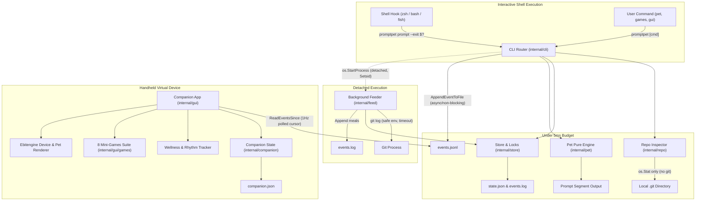

# Architecture & Design

`promptpet` is an ultra-low-latency Go CLI that hosts an interactive virtual pet inside shell prompts (`zsh`, `bash`, `fish`) and an optional retro handheld desktop companion GUI (`promptpet gui`). The pet consumes git commits authored by the user in local repositories, reacts to terminal command outcomes, reminds developers to rest and hydrate, and sleeps when idle.

## Architectural Objectives

1. **Strict Prompt Budget (<5 ms):** Shell prompt latency is critical. `promptpet prompt` must complete well under 5 ms (benchmark verified at ~1.2 ms/op). It performs zero network I/O, zero git subprocess invocations, minimal disk operations, and non-blocking append logging.
2. **Deterministic Domain Logic:** Core pet state transitions, decay mechanics, mood determination, wellness timers, and mini-game rules are pure functions isolated from external side effects.
3. **Decoupled Concurrency & Detached Processing:**
   - Git repository inspection runs asynchronously in a detached daemon process (`promptpet _feed`).
   - Terminal prompt execution and the desktop GUI mini-window communicate asynchronously via append-only event IPC (`events.jsonl`), with zero shared memory, zero locking contention, and zero IPC backpressure.
4. **Resilient Persistence:** State storage uses non-blocking file locking (`flock`), atomic file writes via PID-specific tempfiles, and corrupt file recovery to withstand unexpected crashes, process termination, or multiple concurrent shell sessions.
5. **Minimal Dependencies:** The CLI prompt path uses standard library Go only. The GUI companion subsystem is built on pure-Go Ebitengine with zero CGO requirements.

---

## Component Boundaries



---

## Package Responsibilities

### 1. `internal/pet`: Pure Domain Logic
- **`state.go`**: Definition of `State` and `RepoSig`.
- **`rules.go`**: Time decay formulas (`FoodPerHour`, `FunPerHour`, `HealthPerHour`), meal ingestion, interaction logic (`PetIt`, `Play`), and input validators (`ValidName`, `ValidSpecies`).
- **`mood.go`**: Computes pet `Mood` based on strict priority hierarchy:
  $$\text{Away} \succ \text{Eating} \succ \text{Sick} \succ \text{Confused} \succ \text{Startled} \succ \text{Sleepy} \succ \text{Hungry} \succ \text{Bored} \succ \text{Happy} \succ \text{Content}$$
  Calculates integer `Hearts` ($0$ to $3$) based on average vital statistics.
- **`render.go`**: Generates sanitized ANSI-safe prompt segments (avoiding special shell characters `%`, `$`, `` ` ``, `\`, `"`, `'`) and multi-line ASCII art status cards.

### 2. `internal/store`: Storage Engine & Concurrency
- **State Directory Resolution (`Dir`):**
  1. `$PROMPTPET_HOME` (if non-empty)
  2. `$XDG_STATE_HOME/promptpet` (if `$XDG_STATE_HOME` is an absolute path)
  3. `$HOME/.local/state/promptpet`
- **Concurrency Control (`Lock`):**
  Uses `syscall.Flock` (`LOCK_EX | LOCK_NB`) on lock files (`state.lock`, `feed.lock`). If contested, polls every 500 µs up to a configurable duration.
  - On the prompt hot path, if the lock is busy, it falls back to read-only state loading (`LoadStateReadOnly`) without modifying files, guaranteeing that a busy lock never delays prompt rendering.
- **Atomic File Writing (`WriteAtomic`):**
  Writes data to `path.tmp-<pid>`, flushes to disk, and executes atomic rename (`os.Rename`), preventing half-written or corrupt files on sudden termination.
- **Corrupt File Recovery (`LoadState`):**
  Invalid JSON in `state.json` is automatically backed up to `state.json.corrupt-<timestamp>[-<counter>]` and a fresh default pet is initialized with a warning on stderr (for interactive commands).
- **Log Management (`AppendMeals`, `ReadMeals`):**
  Maintains append-only `events.log` where each record is `meal <timestamp> <sha7>\n`. Records are read incrementally using byte offsets stored in pet state.
- **Feed Cache (`LoadFeed`, `SaveFeed`):**
  Maintains repository commit timestamps in `feed.json`. Automatically prunes entries to retain a maximum of 200 repositories, evicting oldest records first.

### 3. `internal/repo`: Subprocess-Free Git Detection
- **`Find`**: Traverses ancestor directories (up to 64 levels) starting from current working directory to locate `.git`. Detects both traditional `.git` directories and gitdir pointer files used by worktrees and submodules.
- **`Sig`**: Uses `os.Stat` on `.git/logs/HEAD` to determine file size and nanosecond modification time (`MtimeNs`). Changes to this signature indicate local git activity without running `git status` or `git log`.

### 4. `internal/feed`: Background Git Integration
- Runs detached from the shell via `os.StartProcess` with `Setsid: true`.
- Invoked via `promptpet _feed <worktree-path>`.
- Locks `feed.lock` (5-second timeout).
- Runs `git` commands with hardened isolation flags:
  - `GIT_OPTIONAL_LOCKS=0`: Avoids acquiring git index locks.
  - `GIT_TERMINAL_PROMPT=0`: Prevents prompts for credentials.
  - `LC_ALL=C`: Standardizes output language and parsing.
- Case-insensitively matches the local `user.email` against author emails in git log.
- Feeds up to 5 commits per run into `events.log`.

### 5. `internal/cli`: Dispatcher & Dependency Injection
- Wires all commands through `Deps`:
  ```go
  type Deps struct {
      Version string
      Now     func() time.Time
      Rand    *rand.Rand
      Getenv  func(string) string
      Getwd   func() (string, error)
      Spawn   func(worktree string) error
      RunGUI  func(gui.Config) error
      Stdout  io.Writer
      Stderr  io.Writer
  }
  ```
- Dispatches subcommands: `prompt`, `init`, `completion`, `gui`, `pet`, `games`, `play`, `name`, `species`.
- Full testability with deterministic clocks, mocked environments, and captured output buffers.

### 6. `internal/hooks`: Shell Integrations
- Embedded shell hook templates for `bash`, `zsh`, and `fish`.
- Hooks intercept exit statuses (`$?` or `$status`) and inject `PROMPTPET_SEGMENT` into standard prompt structures (`PS1`, `PROMPT`, `fish_prompt`) without mutating user exit codes.

### 7. `internal/event`: Event IPC Pipeline
- **Format:** Append-only line-delimited JSON (`events.jsonl`) storing discrete events:
  ```json
  {"type":"command_finish","exit_code":0,"timestamp":1729768920}
  ```
- **Prompt Producer (`AppendEventToFile`, `LogEvent`):** Appends events with `os.O_APPEND|os.O_CREATE|os.O_WRONLY` (0600 mode). Overhead is under 100 microseconds, ensuring prompt latency stays well below budget.
- **GUI Consumer (`ReadEventsSince`):** Reads events whose `timestamp >= sinceTs`, enabling incremental event streaming with zero cursor locking.
- **Isolation:** Write errors in `events.jsonl` are silently dropped in the prompt path to guarantee shell prompt execution is never interrupted or delayed.

### 8. `internal/companion`: Companion Domain, State & Wellness
- **Companion State (`companion.json`):** Tracks `ActivePet`, `LastWaterTime`, `LastStretchTime`, `LastLookAwayTime`, and `HighScores` for mini-games.
- **Pet Roster (`pet.go`):** 8 distinct pet definitions (`Usagi`, `Kochi`, `Puff`, `Mochi`, `Spook`, `Pippin`, `Gromit`, `Boba`) with custom palettes (primary, accent, blush) and mood-specific quotes.
- **Rhythm Engine (`wellness.go`):** Evaluates command frequency and exit codes over recent windows:
  - High burst velocity $\rightarrow$ `energetic`
  - All recent successes $\rightarrow$ `cheer`
  - Recent non-zero exit errors $\rightarrow$ `sympathy`
  - Idle periods $\rightarrow$ `resting` (contextualized by time of day)
- **Gentle Wellness Reminders:**
  - Water reminder: 45 minute interval
  - Stretch reminder: 50 minute interval
  - 20-20-20 eye rest: 20 minute interval
  - Anti-flooding algorithm staggers overdue reminders to prevent reminder spamming.

### 9. `internal/gui`: Handheld Virtual Device Renderer
- **Retro Handheld Chassis (`device.go`):** Renders curved 240×340 plastic shell with dual speaker grilles, glass LCD bezel, LCD display, and A/B/C action buttons.
- **Vector Pet Graphics (`render_pet.go`):** Dynamic vector pet avatars with 60 FPS animation ticks (idle breathing bounce, synchronized eye blinking, and expressive blushing).
- **Speech Bubble System:** Dynamic speech bubble with rounded borders, pointer tail, and text wrapping.
- **Headless Detection:** Detects headless environments without active display servers (`DISPLAY` / `WAYLAND_DISPLAY`) and returns `gui.ErrHeadless` cleanly.

### 10. `internal/gui/games`: Interactive Mini-Games Suite
- **Interface Abstraction (`game.go`):**
  ```go
  type MiniGame interface {
      Name() string
      Init(pet companion.PetDef)
      Update() (done bool, won bool, score int)
      Draw(screen *ebiten.Image)
  }
  ```
- **8 Mini-Games:**
  1. `SnackCatch`: Paddle-style basket catching falling snacks.
  2. `PuddleLeap`: Timing jump runner avoiding approaching puddles.
  3. `LookAway`: Eye-stretch reflex matching arrow directions.
  4. `RhythmDance`: 4-lane dancing note precision rhythm game.
  5. `MemorySimon`: 3-quadrant pattern recognition and recall.
  6. `WhackABug`: 3-hole pest reaction game with ladybug avoidance.
  7. `BalloonPop`: Angle aiming dart shooter.
  8. `WordSnack`: Keyboard letter typing matching drifting snack names.

---

## Concurrency, Isolation & Throttling Model

- **Zero-Contention Inter-Process Architecture:**
  - Shell prompt process writes to `events.jsonl` and exits in ~1 ms.
  - Background feeder updates git commit history in `events.log` without holding shell locks.
  - GUI companion runs in its own OS process, reading `events.jsonl` and updating `companion.json`.
  - No process shares memory or blocks on another process.
- **Disk I/O Throttling:**
  - The GUI companion window limits event polling to 1 Hz (`lastEventPoll`), avoiding continuous disk reads.
  - Wellness checks run at 0.5 Hz (`lastWellness`).
- **CPU & Power Throttling:**
  - When idle in companion mode, the GUI throttles to 5 FPS / sleeps outside mutex locks, consuming <1% CPU.
  - When a mini-game is active or user interaction occurs, the engine dynamically runs at full 20 FPS for responsive controls.
