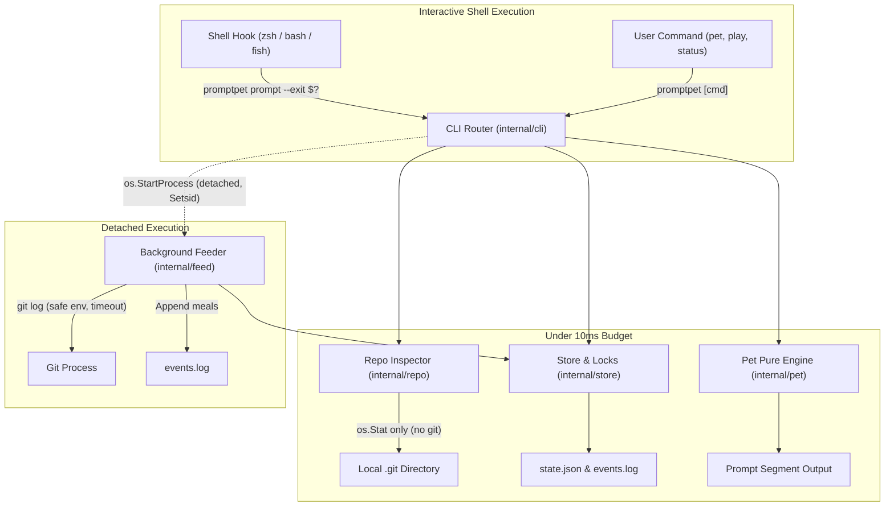

# Architecture & Design

`promptpet` is an ultra-low-latency Go CLI that hosts an interactive virtual pet inside shell prompts (`zsh`, `bash`, `fish`). The pet consumes git commits authored by the user in local repositories, reacts to terminal command outcomes, and decays over time.

## Architectural Objectives

1. **Strict Prompt Budget (<10 ms):** Shell prompt latency is critical. `promptpet prompt` must complete well under 10 ms. It performs zero network I/O, zero git subprocess invocations, and minimal disk operations.
2. **Deterministic Domain Logic:** Core pet state transitions, decay mechanics, mood determination, and rendering are pure functions isolated from external side effects.
3. **Decoupled Concurrency & Detached Processing:** Git repository inspection is performed asynchronously in a detached, daemonized process (`promptpet _feed`) that cannot block or degrade the user's interactive prompt.
4. **Resilient Persistence:** State storage uses non-blocking file locking (`flock`), atomic file writes via PID-specific tempfiles, and corrupt file recovery to withstand unexpected crashes, process termination, or multiple concurrent shell sessions.
5. **Zero External Dependencies:** Built entirely with Go standard library (`math/rand/v2`, `os`, `syscall`, `encoding/json`).

---

## Component Boundaries



---

## Package Responsibilities

### 1. `internal/pet`: Pure Domain Logic
- **`state.go`**: Definition of `State` and `RepoSig`.
- **`rules.go`**: Time decay formulas (`FoodPerHour`, `FunPerHour`, `HealthPerHour`), meal ingestion, interaction logic (`PetIt`, `Play`), and input validators (`ValidName`, `ValidSpecies`).
- **`mood.go`**: Computes pet `Mood` based on strict priority hierarchy:
  $$\text{Away} \succ \text{Eating} \succ \text{Sick} \succ \text{Confused} \succ \text{Startled} \succ \text{Sleepy} \succ \text{Hungry} \succ \text{Bored} \succ \text{Happy} \succ \text{Content}$$
  Calculates integer `Hearts` ($0$ to $3$) based on average vital statistics.
- **`render.go`**: Generates sanitized ANSI-safe prompt segments (avoiding special shell characters `%`, `$`, `` ` ``, `\`, `"`, `'`) and multi-line ASCII art status cards.

### 2. `internal/store`: Storage Engine & Concurrency
- **State Directory Resolution (`Dir`):**
  1. `$PROMPTPET_HOME` (if non-empty)
  2. `$XDG_STATE_HOME/promptpet` (if `$XDG_STATE_HOME` is an absolute path)
  3. `$HOME/.local/state/promptpet`
- **Concurrency Control (`Lock`):**
  Uses `syscall.Flock` (`LOCK_EX | LOCK_NB`) on lock files (`state.lock`, `feed.lock`). If contested, polls every 500 µs up to a configurable duration.
  - On the prompt hot path, if the lock is busy, it falls back to read-only state loading (`LoadStateReadOnly`) without modifying files, guaranteeing that a busy lock never delays prompt rendering.
- **Atomic File Writing (`WriteAtomic`):**
  Writes data to `path.tmp-<pid>`, flushes to disk, and executes atomic rename (`os.Rename`), preventing half-written or corrupt files on sudden termination.
- **Corrupt File Recovery (`LoadState`):**
  Invalid JSON in `state.json` is automatically backed up to `state.json.corrupt-<timestamp>[-<counter>]` and a fresh default pet is initialized with a warning on stderr (for interactive commands).
- **Log Management (`AppendMeals`, `ReadMeals`):**
  Maintains append-only `events.log` where each record is `meal <timestamp> <sha7>\n`. Records are read incrementally using byte offsets stored in pet state.
- **Feed Cache (`LoadFeed`, `SaveFeed`):**
  Maintains repository commit timestamps in `feed.json`. Automatically prunes entries to retain a maximum of 200 repositories, evicting oldest records first.

### 3. `internal/repo`: Subprocess-Free Git Detection
- **`Find`**: Traverses ancestor directories (up to 64 levels) starting from current working directory to locate `.git`. Detects both traditional `.git` directories and gitdir pointer files used by worktrees and submodules.
- **`Sig`**: Uses `os.Stat` on `.git/logs/HEAD` to determine file size and nanosecond modification time (`MtimeNs`). Changes to this signature indicate local git activity without running `git status` or `git log`.

### 4. `internal/feed`: Background Git Integration
- Runs detached from the shell via `os.StartProcess` with `Setsid: true`.
- Invoked via `promptpet _feed <worktree-path>`.
- Locks `feed.lock` (5-second timeout).
- Runs `git` commands with hardened isolation flags:
  - `GIT_OPTIONAL_LOCKS=0`: Avoids acquiring git index locks.
  - `GIT_TERMINAL_PROMPT=0`: Prevents prompts for credentials.
  - `LC_ALL=C`: Standardizes output language and parsing.
- Case-insensitively matches the local `user.email` against author emails in git log.
- Feeds up to 5 commits per run into `events.log`.

### 5. `internal/cli`: Dispatcher & Dependency Injection
- Wires all commands through `Deps`:
  ```go
  type Deps struct {
      Version string
      Now     func() time.Time
      Rand    *rand.Rand
      Getenv  func(string) string
      Getwd   func() (string, error)
      Spawn   func(worktree string) error
      Stdout  io.Writer
      Stderr  io.Writer
  }
  ```
- Full testability with deterministic clocks, mocked environments, and captured output buffers.

### 6. `internal/hooks`: Shell Integrations
- Embedded shell hook templates for `bash`, `zsh`, and `fish`.
- Hooks intercept exit statuses (`$?` or `$status`) and inject `PROMPTPET_SEGMENT` into standard prompt structures (`PS1`, `PROMPT`, `fish_prompt`) without mutating user exit codes.
